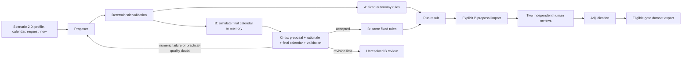

# Architecture

## Flow

`src/scenario_v2.py` validates the schema `2.0` profile/calendar/request; `src/proposer_v2.py` adapts it for the existing structured `Proposal` contract in `src/models.py`. The Proposer receives the complete scenario. `src/llm.py` selects IAedu or Ollama from configuration; API credentials stay in ignored `.env` or environment. B now invokes `src/calendar_v2.py` once per proposal to obtain the exact resulting events and technical report. `src/critic.py` receives **the proposal and structured rationale, the complete resulting calendar, the limited technical validation report and the calendar timezone**. On revisions it also receives its own previous concerns, feedback and proposal, allowing it to judge the Proposer's response. It does not receive the source profile, original calendar as a separate input, original request, annotation or autonomy labels. The Critic scores reasoning, coherence, alternatives and clarity from 1 to 5; its assessment now includes practical temporal plausibility and agreement between rationale and resulting calendar. It does not certify constraints beyond the validator's stated scope.

The Critic calendar includes **all** resulting events in the scenario horizon, including unchanged neighbors; there is no silent token truncation. Each event carries ID, title, local start/end with offset, existing/addition origin and preserved/moved/added status. Existing events retain category, importance, fixed flag, participants and description. The `Proposal` contract does not provide those metadata for additions: the simulator uses neutral defaults internally to validate/apply them, but the Critic view presents those fields as `null`. It does not invent location, commuting time, meal time or personal preferences. Technical validation precedes Critic assessment; invalid changes have no final calendar and are not submitted to the Critic.

`src/pipeline_b.py` runs the B loop with a threshold of 4.0 and at most three **revisions after the initial proposal**. It passes the previous proposal and Critic feedback to the Proposer, then validates and rebuilds the final calendar for each revision. Its iteration record stores proposal, validation, result calendar, feedback and scores; below-threshold runs retain final unresolved Critic weaknesses. Alternatives mentioned in a rationale are not revisions. `src/calendar_v2.py` validates change fields, references, timing, protected events and computable constraints, and simulates applicable changes in memory. Natural-language constraints not encoded as executable rules remain unverified. `src/rules.py` applies the same fixed autonomy logic in A and B; invalid proposals cannot act. B below threshold defers with a distinct `deferred_critic_threshold` status; this is not a trained gate prediction. Technical failures have separate error statuses.

The versioned Critic policy `plausibility_review_v1` adds `PlausibilityReview` without removing the four numeric scores. New provider responses use `CurrentCriticEvaluation`, where `plausibility_review` is required. `CriticEvaluation` reads historical evaluations with that field absent as `None`; absence never means there was no risk. The new review contains a strict boolean `revision_required`, severity `none|low|moderate|high`, reason and suggested improvement. A required revision needs moderate/high severity plus a nonempty reason and actionable suggestion; severity alone cannot trigger a revision. The pipeline accepts exactly when the existing numeric criteria pass **and** `revision_required` is false. If either condition fails, the Proposer receives the relevant feedback; if both fail, it receives both. Every iteration records numeric result, explicit review decision, acceptance result and revision causes. An unresolved request at the limit retains `deferred_critic_threshold`, with the cause recorded separately from a future C gate decision.

`eval/run_config_a_v2.py` and `eval/run_config_b_v2.py` execute one imported scenario explicitly and save unique run JSON under `eval/runs/<run_id>/A|B/`; the prior `B_v2` run remains readable. `src/proposal_catalog_v2.py` imports a B result as an immutable artifact in `data/proposals/`. For new outcome-aware results, import recalculates each recorded calendar from the structured proposal and rejects a mismatch; older artifacts remain compatible. `annotation_app.py` and `src/annotation_v2_ui.py` present the scenario, technical report, final proposal and original/proposed read-only weekly calendars. Failed simulations leave the original calendar intact. `src/annotation_v2.py` validates independent reviews, comparison and consensus in `data/annotations/`; `src/gate_dataset_v2.py` exports eligible rows only. The UI does not call the LLM when opened.

## Safety and evidence boundaries

Structural validity, computable hard constraints, scheduling acceptability, contextual plausibility and autonomy are distinct judgments. A technically invalid proposal cannot become an `act` or a normal supervised gate example. Human reviewers can mark an otherwise technical proposal as unacceptable; this is a quality rejection with no autonomy label. The Critic distinguishes demonstrable contradictions from plausible risks and subjective preferences; it may suggest transition time when the visible schedule warrants it but cannot impose a universal buffer or infer unknown travel needs. A Critic score is not scheduling or autonomy ground truth. The future C gate must use only permitted pre-label features and keep test families locked during training.

The policy exists because a four-dimension average of 4.25 previously approved a proposal despite a concrete plausibility concern. The explicit review decision is produced by the Critic, not inferred from the average. A moderate concern may be logged with `revision_required=false` when evidence or expected benefit is insufficient. A revision requests another Proposer attempt; compare initial and final proposals and use later human review to determine whether scheduling actually improved.

## Quality-control review

The Critic asks whether the final calendar is workable and balanced, not merely whether events fit into free slots. A concrete, relevant doubt about a proposal-induced transition, fatigue or workload can justify `revision_required=true` without proving an objective violation. Minor or speculative observations do not. No universal buffer, meal, sleep or travel rule is added to the technical validator. Feedback requests **re-evaluation**: the Proposer may preserve every operation while explaining the trade-off with available facts. On the next iteration, the Critic sees its prior concern and previous proposal; a longer rationale or repeated claim of technical validity is not evidence by itself. The run records prior concerns, feedback, whether operations/rationale changed, and the next Critic judgment. A continuing doubt at the revision limit remains unresolved rather than approved. The Critic's contextual judgment does not establish real-world feasibility, request satisfaction or autonomy suitability.
