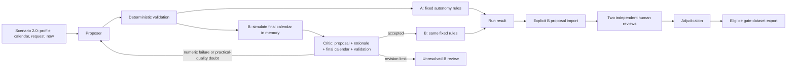

# Architecture

## Flow



`src/scenario_v2.py` validates the schema `2.0` profile/calendar/request; `src/proposer_v2.py` adapts it for the existing structured `Proposal` contract in `src/models.py`. The Proposer receives the complete scenario. `src/llm.py` selects IAedu or Ollama from configuration; API credentials stay in ignored `.env` or environment. B now invokes `src/calendar_v2.py` once per proposal to obtain the exact resulting events and technical report. `src/critic.py` receives **the proposal and structured rationale, the complete resulting calendar, the limited technical validation report and the calendar timezone**. On revisions it also receives its own previous concerns, feedback, proposal and simulated resulting calendar, allowing it to judge the Proposer's response and any new regression. It does not receive the source profile, original calendar as a separate input, original request, annotation or autonomy labels. The Critic scores reasoning, coherence, alternatives and clarity from 1 to 5; its assessment now includes practical temporal plausibility and agreement between rationale and resulting calendar. It does not certify constraints beyond the validator's stated scope.

The IAedu-facing Proposer contract is versioned separately as
`compact_proposal_v1`. It is a discriminated union: `add` exposes only addition
fields; `move` exposes an event reference and destination; `delete` exposes only
the event reference. Redundant source timestamps and titles on existing events
are read from the scenario rather than repeated by the model, absent optional
fields are omitted instead of serialized as `null`, and rationale strings/lists
have generous concision bounds. `src/proposer_v2.py` immediately converts this
wire object into the canonical `Proposal`; simulation, fixed autonomy rules,
Critic packets, UI, catalogue, annotations and historical run JSON therefore
retain their existing schema. B revisions send the previous proposal in compact
form when compatible. A manually replayed older proposal that exceeds the new
prose bounds is passed intact in its historical canonical form rather than
silently truncated. Every new A/B run records both
`proposer_wire_schema_version` and `proposer_wire_schema_sha256` alongside prompt
hashes. Runs with different wire-schema hashes are distinct experimental
versions and must not be pooled as if the generation protocol were unchanged.

The Critic calendar includes **all** resulting events in the scenario horizon, including unchanged neighbors; there is no silent token truncation. Existing events retain their metadata. For additions, validated `category`, `importance` and `participants` from the typed `Proposal` are preserved in `result_calendar`; an individually absent field remains `null`, while neutral simulator defaults stay internal. No metadata is inferred from raw model text. Historical result calendars retain their versioned legacy `null` representation. Technical validation precedes Critic assessment; invalid changes have no final calendar and are not submitted to the Critic.

`src/pipeline_b.py` runs the B loop with a threshold of 4.0 and at most three **revisions after the initial proposal**. It passes the previous proposal and Critic feedback to the Proposer, then validates and rebuilds the final calendar for each revision. Its iteration record stores proposal, validation, result calendar, feedback and scores; below-threshold runs retain final unresolved Critic weaknesses. Alternatives mentioned in a rationale are not revisions. `src/calendar_v2.py` validates change fields, references, timing, protected events and computable constraints, and simulates applicable changes in memory. Natural-language constraints not encoded as executable rules remain unverified. `src/rules.py` applies the same fixed autonomy logic in A and B; invalid proposals cannot act. B below threshold defers with a distinct `deferred_critic_threshold` status; this is not a trained gate prediction. Technical failures have separate error statuses.

The historical `plausibility_review_v1` policy added `PlausibilityReview` without removing the four numeric scores. The new policy is `uncertainty_review_v2`: `CurrentCriticEvaluation` requires both `plausibility_review` and `unresolved_assumptions`; `PlausibilityCriticEvaluation` reads v1, while `CriticEvaluation` reads still older responses. Missing historical uncertainty information is `None`, distinct from an explicit empty list. `UnresolvedAssumption` records `subject`, `assumption`, `evidence_gap`, `potential_impact` (`minor|material|potentially_blocking`) and `verification_source` (`external_source|user_context|third_party|unknown`). It is evidence about an unverified condition, not authorization or a technical violation. The existing acceptance rule is unchanged: numeric criteria pass **and** `revision_required` is false. Uncertainty does not enter this Boolean rule or the fixed autonomy rules. Every iteration records its list; the run and imported artifact retain `uncertainty_history` and `final_unresolved_assumptions`. The UI distinguishes current, earlier and unavailable assessments. An earlier condition omitted later has **unknown resolution** unless independently verified; disappearance from the text is not proof of resolution.

Illustrative new response fragment (the actual response also requires four scores, weaknesses and feedback):

```json
{
  "plausibility_review": {
    "revision_required": false,
    "severity": "low",
    "reason": "The moved appointment may depend on an external schedule, but no concrete calendar conflict is visible.",
    "suggested_improvement": ""
  },
  "unresolved_assumptions": [{
    "subject": "event_17",
    "assumption": "The external facility is available at the proposed time",
    "evidence_gap": "No operating hours are provided",
    "potential_impact": "material",
    "verification_source": "external_source"
  }]
}
```

This example accepts quality while retaining an unverified condition. The schema intentionally has no `requires_external_confirmation` or ACT/DEFER flag: a factual lookup and human authorization are different actions. Do not turn `potential_impact` into an autonomy threshold.

Within `uncertainty_review_v2`, listing a condition and requesting a revision remain separate judgments. The Critic asks whether a concrete unresolved dependency matters to the proposal's stated goal, whether the Proposer has context to reconsider it, whether an alternative might reduce it, and whether the issue has already been considered productively. Lack of an objective contradiction alone does not settle that question. Repeated absence of external information alone does not justify repeated reviews. When `potential_impact=material` but `severity=low`, the Critic should explain the distinction between consequences if the assumption is false, evidence that it is false, relevance to the plan and expected value of another review. The Boolean decision remains explicit; the pipeline does not infer it from assumptions or severity.

`eval/run_config_a_v2.py` and `eval/run_config_b_v2.py` atomically publish technically completed runs under `eval/runs/treino/<family>/<scenario_id>/<run_id>/A|B/<scenario_id>.json`, or the corresponding `avaliacao/desenvolvimento` and `avaliacao/teste` roots. Technical provider, parsing, validation and serialization failures are not published. `eval/run_training_b_v2.py` reuses B sequentially, validates the final 60/10/30 manifest and readiness table, excludes blocked training cases and skips only experimentally compatible completed B runs. Recursive discovery remains compatible with historical layouts without duplicate catalogue entries. Proposal import, Streamlit and gate export resolve scenarios through the structured final manifest; the gate exporter continues to select only the requested split.

## Safety and evidence boundaries

Structural validity, computable hard constraints, scheduling acceptability, contextual plausibility and autonomy are distinct judgments. A technically invalid proposal cannot become an `act` or a normal supervised gate example. Human reviewers can mark an otherwise technical proposal as unacceptable; this is a quality rejection with no autonomy label. The Critic distinguishes demonstrable contradictions from plausible risks and subjective preferences; it may suggest transition time when the visible schedule warrants it but cannot impose a universal buffer or infer unknown travel needs. A Critic score is not scheduling or autonomy ground truth. The future C gate must use only permitted pre-label features and keep test families locked during training.

The policy exists because a four-dimension average of 4.25 previously approved a proposal despite a concrete plausibility concern. The explicit review decision is produced by the Critic, not inferred from the average. A moderate concern may be logged with `revision_required=false` when evidence or expected benefit is insufficient. A revision requests another Proposer attempt; compare initial and final proposals and use later human review to determine whether scheduling actually improved.

## Quality-control review

The Critic asks whether the final calendar is workable and balanced, not merely whether events fit into free slots. A concrete, relevant doubt about a proposal-induced transition, fatigue or workload can justify `revision_required=true` without proving an objective violation. Minor or speculative observations do not. No universal buffer, meal, sleep or travel rule is added to the technical validator. Feedback requests **re-evaluation**: the Proposer may preserve every operation while explaining the trade-off with available facts. On the next iteration, the Critic sees its prior concern and previous proposal; a longer rationale or repeated claim of technical validity is not evidence by itself. The run records prior concerns, feedback, whether operations/rationale changed, and the next Critic judgment. A continuing doubt at the revision limit remains unresolved rather than approved. The Critic's contextual judgment does not establish real-world feasibility, request satisfaction or autonomy suitability.

The Critic checks two questions independently on each revision: whether the prior concern was addressed and whether the revised calendar introduces new practical risks or unsupported external dependencies. Previous and current resulting calendars are derived by the same deterministic simulator. The prompt distinguishes a free slot, a checked constraint and actual operational availability; a flexible event may depend on unknown opening hours, facilities, people or transport. Unknown facts are uncertainty, not technical violations. The Proposer receives this same conceptual guidance in its **shared base prompt** for A and B; its version hash changes in both. The structured list may later be considered as evidence for C only under a separately frozen feature protocol. `potential_impact` and `verification_source` do not decide ACT/DEFER, and factual verification differs from human authorization.

The current Critic system prompt is organized around one primary question: whether the resulting routine is realistically manageable, balanced and sustainable for the person represented by the visible calendar. It considers cumulative effort, plausible everyday needs, rest, personal time, weekly distribution and whether reserved time is likely to be useful. It does not infer unseen availability or universal requirements for meals, travel or breaks. The previous instruction to give objective problems greatest weight was removed because the deterministic validator already handles computable hard constraints, and a human-quality concern can merit revision without an objective contradiction. Repeated cautions about uncertainty and technical validity were consolidated into one evidence boundary. `reasoning` now explicitly covers practical capacity and trade-offs; `coherence` covers the operation/rationale/result agreement **and** whether the resulting routine is realistically workable. The four 1–5 scores, their average, 4.0 threshold and explicit plausibility decision are unchanged. A high score alongside a material human-quality weakness should be explained by the Critic, but the pipeline does not impose a new deterministic score relation.

On a quality review, the Critic describes the visible concern and its consequence, then asks the Proposer to reconsider the whole plan with the original context. It never supplies replacement operations or a mandatory time. The Proposer's revision-only guidance now cautions that a small timing shift can leave the underlying fatigue, recovery or effectiveness concern unresolved. The Proposer may keep the same operations with grounded reasoning. Prompt hashes on B runs distinguish this revision from older Critic behavior; historical artifacts remain unchanged and should not be pooled without version control.
