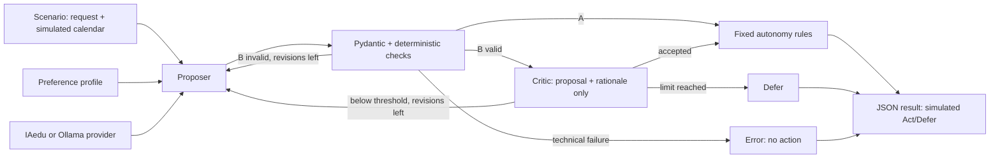

# Architecture and data contracts

## System boundary

`eval/run_config_a.py` and `eval/run_config_b.py` load a synthetic `Scenario` and `Profile`, call the selected LLM provider, and write JSON records under `eval/runs/<run_id>/A/` or `/B/`. `src/calendar_ops.py` simulates changes in memory. There is no real calendar write path. The proposal's n8n orchestration and Google Calendar API are not yet present.

## Contracts and responsibilities

| Component | Input | Output and responsibility |
| --- | --- | --- |
| `src/models.py` | JSON objects | Pydantic v2 `Profile`, `Scenario`, `Change`, `Proposal`, `CriticEvaluation`; validates required fields for `add` (`title`, `to_start`), `move` (`event_id`, `to_start`) and `delete` (`event_id`). `Rationale` carries constraints, priorities, alternatives and summary. |
| `src/proposer.py` | User request, synthetic calendar, profile; on revision, previous proposal and feedback | A structured `Proposal`. The same function and prompt serve A and B. It is instructed to respect fixed events and preferences, but instructions alone are not guarantees. |
| `src/calendar_ops.py` | Original calendar, proposal, profile | `find_violations` and in-memory `apply_changes`. Rejects invalid references/dates/durations, moving/deleting fixed events, changed-event overlap with fixed events, out-of-hours/weekend changes and some ineffective or duplicate changes. Coverage is partial. |
| `src/critic.py` | Structured proposal, including its rationale | `CriticEvaluation` with four scores from 1–5, weaknesses and actionable feedback. No direct request, calendar or profile parameter. It judges statements visible in the proposal, not actual calendar correctness. |
| `src/pipeline_b.py` | Same scenario and profile, Proposer/Critic providers, `CriticSettings` | Initial proposal plus at most three revisions by default; every iteration records proposal, validation and, if valid, Critic evaluation. |
| `src/rules.py` | Final proposal, original calendar, violations | `act` or `defer` plus reasons; shared unchanged by A and B. |
| `src/llm.py` | Prompt and target Pydantic class | A provider protocol with `generate_structured` and `generation_config`; IAedu and Ollama implementations. |

`Scenario` still contains legacy `annotations`, `reference_decision` and `draft_label` fields. Current human labels reside instead in the two-phase workflow; `draft_label` is preliminary generator metadata and must never be treated as ground truth. `GateFeatures` in `src/models.py` is an older contract; the current prepared predictive schema is `GatePredictors` in `src/gate_dataset.py`. Neither constitutes a trained gate.

## A and B execution

**A:** validate a single LLM `Proposal` with Pydantic, run `find_violations`, then call `rule_based_decision`. The result contains proposal, violations, decision, reasons, provider/model/generation metadata, status and duration. A can return `defer` for an invalid proposal; the status remains `invalid_proposal`, distinct from a successful ready proposal. `LLMError` yields `llm_error` and no decision. The current A runner does not wrap every possible validator exception; a validator crash is not a successful action.

**B:** `CriticSettings` defaults to mean score ≥4.0/5, minimum dimension ≥1 and up to three revisions. Revision index 0 is the initial proposal, indices 1–3 are revisions. Each proposal is deterministically checked before critique. Invalid proposals receive validator feedback for another revision and, at the limit, `deferred_invalid_proposal`. Valid proposals go to the Critic. A below-threshold score produces feedback for another revision or `deferred_critic_threshold` at the limit. Once accepted, B calls the *same* `rule_based_decision` as A. `proposer_error`, `critic_error` and `validation_error` record `safe_action=no_autonomous_action`; these are technical failures, not valid human deferrals. B stores initial/final proposals, all iterations, score, revision count, final decision and duration.

The Critic's average is a rationale score. It is not a scheduling quality score. The deterministic validator does not prove semantic request satisfaction either; `src/quality_checks.py` keeps structural, applicability, constraints, request satisfaction, rationale quality and autonomy appropriateness separate.

## LLM providers and configuration

`get_provider(role=...)` selects `PROPOSER_LLM_PROVIDER` or `CRITIC_LLM_PROVIDER`, falling back to `LLM_PROVIDER`. A/B default to the same provider/model; the B CLI permits a separate Critic for a future controlled experiment. Compare A and B only with matched Proposer settings. The IAedu provider sends an HTTPS multipart POST with `x-api-key`, `channel_id`, a new UUID `thread_id`, `user_info={}` and `message`. `requests` generates the multipart boundary; no incomplete `Content-Type` is set. The client assembles streaming `token` events, applies a prompt-based JSON format instruction, extracts a JSON object and validates it locally with Pydantic. It has bounded invalid-JSON retries, connection/read timeouts and sanitized HTTP/communication errors. It does not rely on an OpenAI-compatible API or native JSON Schema enforcement.

The Ollama alternative posts to `/api/generate` with an Ollama JSON Schema format and validates the response. Both providers satisfy the same interface. Provider/model and available generation settings are written to run records. The IAedu model label is metadata; the actual channel controls the deployed model. See [Setup and testing](06_SETUP_AND_TESTING.md) for safe configuration.

## Fixed autonomy and failure boundaries

`rule_based_decision` defers for any violation, no concrete changes, more than two changes, any deletion, touched event importance ≥4, or touched categories `health`, `supervisor_meeting` and `social`. Otherwise it returns `act`. These rules are a baseline, not an approved final policy. The category list cannot stand in for a proposal-specific human judgement. [Autonomy policy draft](08_AUTONOMY_POLICY_DRAFT.md) discusses richer factors without changing the code.

The only implemented fallback on provider or validation failure is **no autonomous action** with an error status. There is no automatic switch from IAedu to Ollama and no real calendar side effect. Human confirmation handling is not implemented; `defer` is a recorded decision only.
