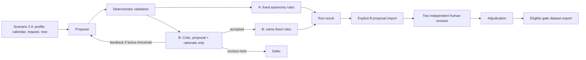

# Architecture

## Flow

`src/scenario_v2.py` validates the schema `2.0` profile/calendar/request; `src/proposer_v2.py` adapts it for the existing structured `Proposal` contract in `src/models.py`. The Proposer receives the complete scenario. `src/llm.py` selects IAedu or Ollama from configuration; API credentials stay in ignored `.env` or environment. `src/critic.py` receives only the proposal and its rationale. It does not receive the source profile, calendar, original request, annotation or labels through a separate channel. The Critic scores reasoning, coherence, alternatives and clarity from 1 to 5, supplies feedback, and does not certify calendar constraints.

`src/pipeline_b.py` runs the B loop with a threshold of 4.0 and at most three **revisions after the initial proposal**. It passes the previous proposal and Critic feedback to the Proposer. It records each iteration and technical failures. `src/calendar_v2.py` validates change fields, references, timing, protected events and computable constraints, and simulates applicable changes in memory. Natural-language constraints not encoded as executable rules remain unverified. `src/rules.py` applies the same fixed autonomy logic in A and B; invalid proposals cannot act. B below threshold defers. Technical failures are recorded separately from a legitimate defer.

`eval/run_config_a_v2.py` and `eval/run_config_b_v2.py` execute one imported scenario explicitly and save unique run JSON under `eval/runs/<run_id>/A|B/`; the prior `B_v2` run remains readable. `src/proposal_catalog_v2.py` imports a B result as an immutable artifact in `data/proposals/`. `annotation_app.py` and `src/annotation_v2_ui.py` present the scenario, technical report, final proposal and original/proposed read-only weekly calendars. Failed simulations leave the original calendar intact. `src/annotation_v2.py` validates independent reviews, comparison and consensus in `data/annotations/`; `src/gate_dataset_v2.py` exports eligible rows only. The UI does not call the LLM when opened.

## Safety and evidence boundaries

Structural validity, computable hard constraints, scheduling acceptability and autonomy are distinct judgments. A technically invalid proposal cannot become an `act` or a normal supervised gate example. Human reviewers can mark an otherwise technical proposal as unacceptable; this is a quality rejection with no autonomy label. Critic scores are rationale assessments, not scheduling or autonomy ground truth. The future C gate must use only permitted pre-label features and keep test families locked during training.
